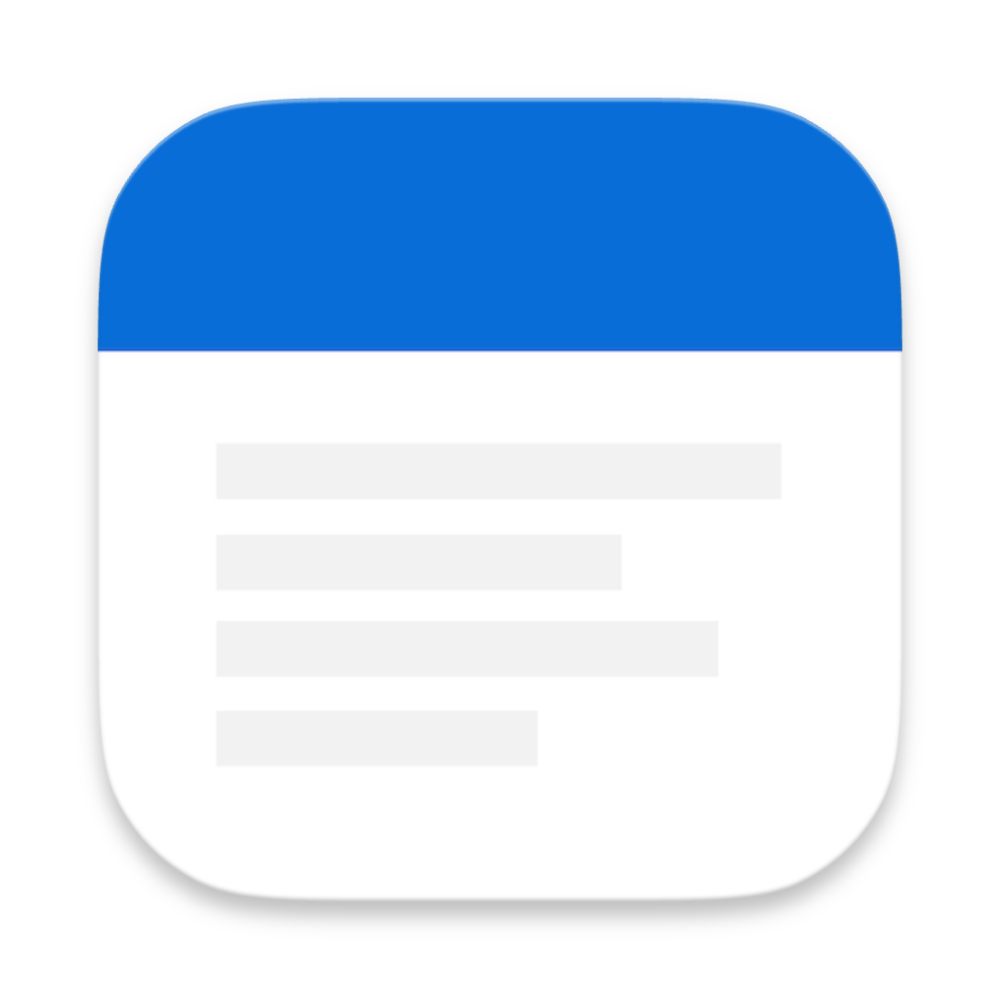
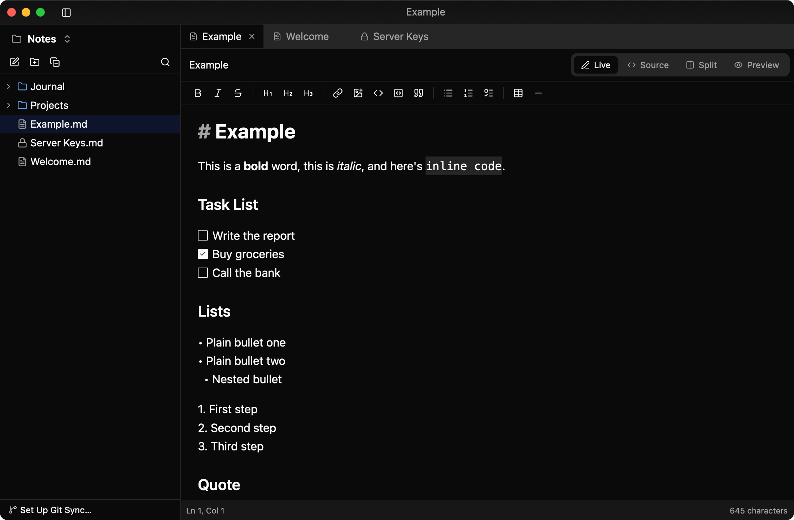
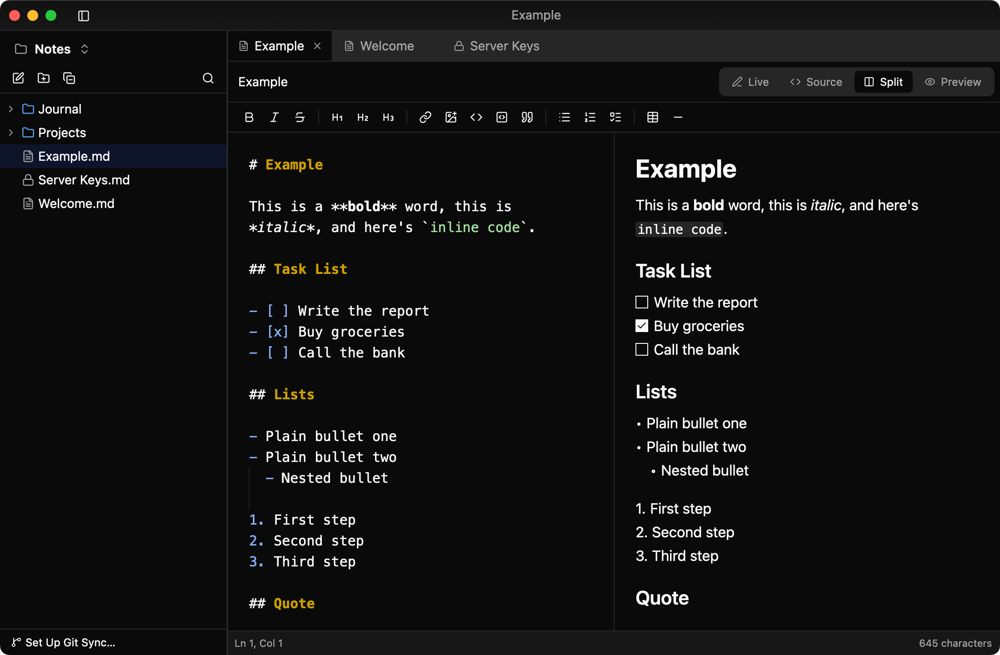
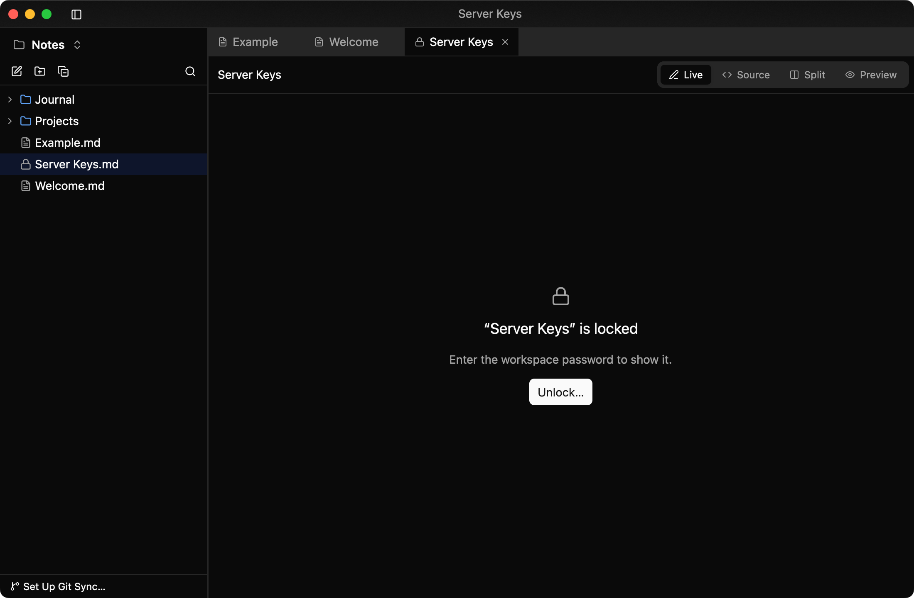

<div align="center">
  
  <h1>Dotnote</h1>
  <p>
    <a href="https://github.com/sofyan-rs/dotnote-gpui/releases/latest"></a>&nbsp;&nbsp;
    <a href="LICENSE"></a>
  </p>
  <p>
    <a href="https://ko-fi.com/Q7Q02B3OYT"></a>
  </p>
</div>

A minimal, cross-platform markdown vault app. It's built in Rust with [GPUI](https://www.gpui.rs/) and [GPUI Kit](https://gpui-kit.com/), and runs on **macOS, Windows, and Linux (Fedora)** from one codebase.

Open any folder on disk as a workspace (a "vault"), browse it in a sidebar, and edit markdown files directly. Switch between your workspaces in one click. Files on disk are the only source of truth, so there is no database or lock-in. Optionally, a vault can sync through your own git repository.







> **Status:** v1.0.

## Download

Get the latest version from [Releases](https://github.com/sofyan-rs/dotnote-gpui/releases/latest):

| System | File |
|---|---|
| macOS (Apple Silicon) | `Dotnote-<version>-arm64.dmg`: open it and drag Dotnote to Applications. The app isn't notarized yet, so the first time, right-click it → *Open*. |
| Windows 10+ (x64) | `Dotnote-<version>-windows-x64-setup.exe`: run it (no admin needed). Windows SmartScreen may warn because the app isn't signed yet: *More info* → *Run anyway*. Or use `Dotnote-windows-x64.zip`: unzip and run `Dotnote.exe`. |
| Fedora | From the Copr repository, updated by dnf: `sudo dnf copr enable kurodev/dotnote && sudo dnf install dotnote`. Or the rpm from the release: `sudo dnf install ./Dotnote-fedora-x86_64.rpm` (x86_64). |
| Linux (x86_64) | `Dotnote-x86_64.AppImage`: `chmod +x Dotnote-x86_64.AppImage` and run it. Keep it in a folder you own (e.g. `~/Applications`) so it can update itself. Needs a Vulkan driver. |

Dotnote checks for a new release at launch and from *Dotnote → Check for Updates…*, then downloads, verifies, and installs it in place (the AppImage too). The Copr package is updated by dnf instead.

## Features

- **Workspaces:** open any folder as a workspace (vault). Notes stay as plain `.md` files.
- **Switch workspaces** from the switcher at the top of the sidebar or *File → Open Recent*. Each workspace reopens with its own tabs; the last one opens at launch.
- **File tree:** click to select, double-click a folder to expand or collapse, drag and drop to move, and a context menu (new file or folder, rename, delete to trash, reveal in file manager, copy path or relative path).
- **Four view modes on one markdown buffer:**
  - **Live:** formats as you type, like Obsidian Live Preview. Markers hide when the cursor leaves them.
  - **Source:** raw markdown with syntax highlighting, like VS Code or Zed.
  - **Split:** source and rendered preview side by side.
  - **Preview:** read-only rendered document.
- **Formatter bar:** bold, italic, strikethrough, H1–H3, link, image, inline code, code block, quote, bullet/numbered/task lists, table, horizontal rule.
- **Images:** inserted images are copied into a `.img` folder next to the note and shown in Live and Preview.
- **CommonMark preview:** headings, emphasis, inline code, fenced code blocks, ordered, unordered, and task lists, blockquotes, links, rules.
- **Autosave:** debounced atomic writes, with no save button and no data loss on quit.
- **Tabs** like VS Code: preview tabs, pin, close others/to the right/saved/all, drag to reorder, copy path, reveal in file manager; reopened on launch.
- **Quick switcher** (`Ctrl/⌘+K`): filter all notes by name and open one from the keyboard.
- **Live external sync:** changes made outside the app show up automatically.
- **Locked notes:** right-click a note → *Lock Note* to encrypt it (for credentials). One password per workspace (change it from *File → Change Notes Password…*); notes lock again after 5 minutes. Encrypted with [age](https://age-encryption.org), so they also open with the `age` tool: `age -d .dotnote-lock.age > key.txt`, then `age -d -i key.txt "Note.md.age"`.
- **Git sync (optional):** enter a repository address (e.g. on GitHub) and the workspace syncs automatically. Uses the git installed on your computer and its sign-in; a note changed on two computers keeps both versions.
- **Updates itself** from GitHub Releases: download, SHA-256 check, install, restart. The launch check can be turned off in Settings.
- **Settings** (`Ctrl/⌘+,` or *Dotnote → Settings…*): theme (System / Light / Dark), update checks, and the open workspace's git sync, notes password, and recent list.

## Requirements

- Rust ≥ 1.92
- macOS 15+, Windows 10+ (MSVC toolchain), or Fedora Linux (Wayland/X11 with Vulkan)

Per-platform setup is in [docs/CONTRIBUTION.md](docs/CONTRIBUTION.md#1-prerequisites).

## Build

```bash
cargo run -p dotnote            # debug
cargo run -p dotnote --release  # release
cargo test --workspace
```

## Docs

- [Architecture](docs/ARCHITECTURE.md): stack, project structure, state model, components, cross-platform concerns, feature summary
- [Contributing](docs/CONTRIBUTION.md): setup, conventions, testing, PR checklist

## Scope

This is intentionally minimal: no wikilinks, backlinks, graph view, tags, or plugins. Sync is optional and only through your own git repository. The whole app is "open a folder, browse it, edit markdown."

## License

[MIT](LICENSE)
